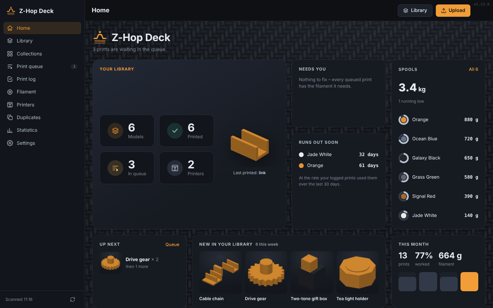
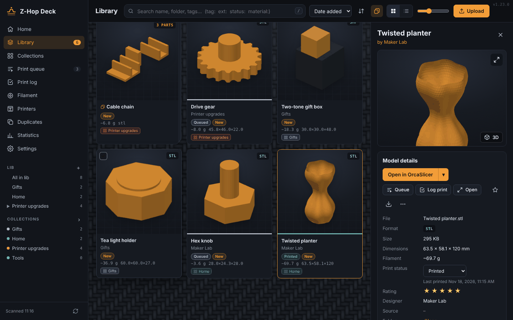
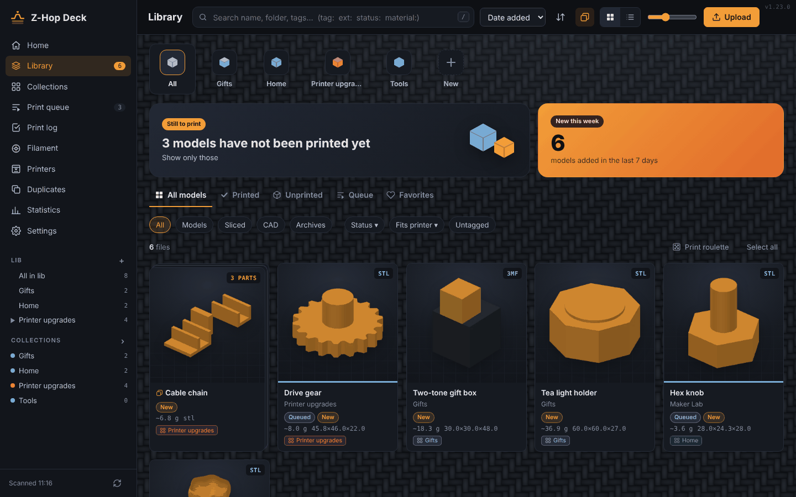
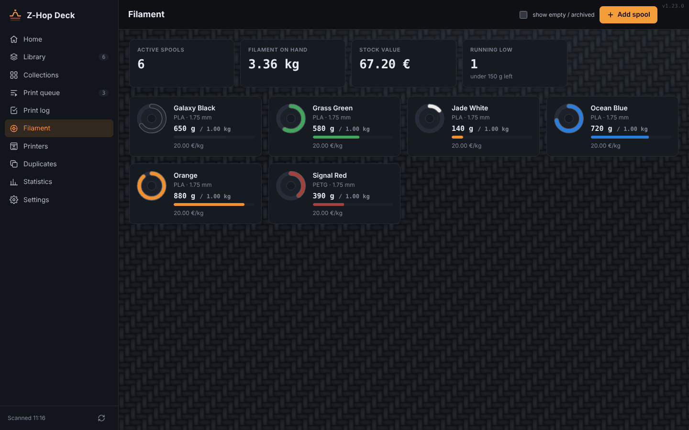

<p align="center"></p>

<h1 align="center">Z-Hop Deck</h1>

<p align="center"><b>A self-hosted library for your 3D-printing files.</b><br>
Point it at the folder with your models, open it in a browser and get previews, slicer data, a 3D viewer,<br>
your filament, your printers and a print log – all on your own server, no cloud.</p>

<p align="center">
<a href="docs/installation.md">Installation</a> ·
<a href="docs/user-guide.md">User guide</a> ·
<a href="docs/orcaslicer.md">OrcaSlicer setup</a> ·
<a href="CHANGELOG.md">Changelog</a> ·
<a href="PRIVACY.md">Privacy</a>
</p>



## What it does

- **Indexes the folders you already have.** STL, 3MF, OBJ, STEP, OpenSCAD, G-code, ZIP – with rendered previews, dimensions, estimated filament, and the print time, material and settings your slicer wrote into the file. Your folder structure stays as it is; Z-Hop Deck never moves anything on its own.
- **Model folders.** A folder with several parts (a Printables or MakerWorld download, for example) shows up as one model card. Open it to see the parts, their photos, PDFs and readme.
- **3D viewer in the browser.** Orbit and zoom around your models on a build plate the size of your printer. Multi-colour 3MF files show their filament colours, G-code shows the toolpath layer by layer, coloured like in OrcaSlicer.
- **Open in slicer.** One click loads a model straight into OrcaSlicer, Cura, PrusaSlicer or Bambu Studio on your PC.
- **Printers.** Live status for Klipper/Moonraker, OctoPrint and PrusaLink printers, and *Send to printer*. OrcaSlicer can upload sliced G-code to Z-Hop Deck as if it were OctoPrint: the file is stored next to its model and passed on to the printer.
- **Print log that fills itself.** Upload from OrcaSlicer, print, and the finished Moonraker job is logged automatically with time, filament, spool and cost – [set it up in 5 minutes](docs/orcaslicer.md). Or log prints by hand.
- **Filament.** Spools with colour, material, price and remaining weight – or connect [Spoolman](https://github.com/Donkie/Spoolman) and let it be the source of truth. The home page warns when a spool is about to run out, or when the print queue needs a filament you don't have.
- **Organise.** Collections, tags, ratings, favourites, print status, notes, designer and source. Search with filters (`tag:` `ext:` `material:` …), "fits on my printer", duplicates finder, statistics.
- **Your server, your rules.** Runs in Docker on anything from a Raspberry Pi to a NAS. Works with a reverse proxy and single sign-on (Authelia, Authentik). No account, works offline.
- **Private by design.** No telemetry, no analytics, no tracking, no cloud – the app only talks to the printers and the Spoolman you set up. See [PRIVACY.md](PRIVACY.md).



## Quick start

You need a Linux machine with Docker. Your models are in a folder on that machine (for example `/srv/3d-models`).

```bash
mkdir -p /opt/zhopdeck && cd /opt/zhopdeck
curl -fsSLO https://raw.githubusercontent.com/er9xuser/z-hop-deck/main/docker-compose.yml
curl -fsSL  https://raw.githubusercontent.com/er9xuser/z-hop-deck/main/.env.example -o .env
nano .env                      # at least LIBRARY_PATH and APP_PASSWORD
docker compose pull
docker compose up -d
```

Open `http://<server-ip>:8080`. The first scan of your library starts by itself; its progress is shown at the bottom of the menu.

Other ways to install (from source, the guided `install.sh`, Proxmox LXC), reverse proxy and single sign-on setup: **[Installation](docs/installation.md)**.

## Updating

```bash
cd /opt/zhopdeck
docker compose pull && docker compose up -d
```

Your database, previews and settings live in `./data` and are kept. The version is shown in the top-right corner of the app.

## More screenshots

| Library | Filament |
|---|---|
|  |  |

## Supported files

| Type | What you get |
|---|---|
| STL, OBJ, 3MF | Preview, 3D view, size, volume, estimated filament. 3MF: slicer data, embedded picture, multi-colour view |
| G-code, `.gcode.3mf` | Slicer picture or rendered toolpath, print time, filament, material, settings, toolpath viewer |
| STEP / STP | Converted to a mesh (OpenCASCADE): preview, 3D view, size, *Download STL* |
| OpenSCAD `.scad` | Rendered with OpenSCAD: preview, 3D view, *Open in slicer*, *Download STL*, code view |
| ZIP | Extracted on upload (optional) or listed; preview of the largest model |
| Images, PDF, TXT, Markdown | Shown with the model: photo gallery, PDF viewer, readme |
| IGES, F3D, Blend, BGCode | Indexed and downloadable, preview from an image in the same folder |

## Requirements

- Docker with Compose v2 (`docker compose`). Linux `amd64` or `arm64` (Raspberry Pi 4/5).
- About 1 GB of RAM for the app; 2 GB is comfortable for large models, STEP and OpenSCAD.
- A modern browser. Phones and tablets work too.

## Acknowledgements

The idea and the dashboard layout were inspired by [Printventory](https://github.com/TechJeeper/Printventory) and [JusttPrint](https://github.com/ngolston/JusttPrint). Z-Hop Deck is an independent project and shares no code with them.

## Contributing

Bug reports and ideas are welcome as GitHub issues. The app is plain Python (Flask) and vanilla JavaScript with no build step – see the project layout in [docs/installation.md](docs/installation.md#development).

## License

[MIT](LICENSE) © er9xuser
