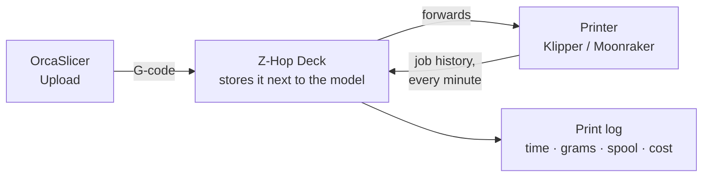

# OrcaSlicer: upload, print and log automatically

With this setup you slice in OrcaSlicer as usual and press **Upload**. Z-Hop Deck then

1. stores the G-code in your library, **next to the model it was sliced from**,
2. passes it on to your printer,
3. and, once the print has finished, **logs it by itself** – time, filament, spool and cost – and marks the model as *Printed*.

Z-Hop Deck answers like an OctoPrint server, so OrcaSlicer (and PrusaSlicer, Bambu Studio, SuperSlicer) can use it as their *print host* without any plugin.

**Automatic logging needs a Klipper printer with Moonraker** (Mainsail, Fluidd). OctoPrint and PrusaLink printers get the upload too, but you log their prints by hand ([below](#octoprint-and-prusalink)).

---

## 1. Add the printer in Z-Hop Deck

**Printers → Add printer**

| Field | Example |
|---|---|
| Name | `Voron 2.4` |
| Build volume | `350 × 350 × 340` |
| Connection | **Klipper / Moonraker** |
| Address | the printer's IP: `http://192.168.1.30` |
| API key | only if Moonraker authorization is on |
| Web address for the browser *(optional)* | `https://voron.example.lan` – what *Open Mainsail* opens |

Click **Test connection** – it must show the printer's state. Use the IP as the address, not a domain behind a login portal (Authelia, Authentik): Z-Hop Deck would get the login page instead of printer data.

## 2. Switch on the automatic print log

**Settings → OrcaSlicer upload → Automatic print log** – on.

From now on Z-Hop Deck reads the job history of every Moonraker printer once a minute. Only jobs that start **after** you switch it on are logged, so your old history is not imported.

## 3. Copy the address and API key

Still in **Settings → OrcaSlicer upload** you see, for every printer:

- **Hostname, IP or URL** – e.g. `http://192.168.1.10:8080/p/2` (the number is the printer)
- **API Key** – the same for all printers

Each printer has its own URL, so one Z-Hop Deck can serve several printers.

Use the **direct address** of Z-Hop Deck (`http://<server-ip>:8080/p/…`), not a domain behind a login portal: OrcaSlicer can't log in there. The API key protects the upload.

## 4. Set it up in OrcaSlicer

1. Select the printer profile in OrcaSlicer and click the **Wi-Fi icon** next to the printer name (*Connection / Physical printer settings*).
2. **Host type:** `Octo/Klipper`
3. **Hostname, IP or URL:** paste the URL from step 3.
4. **API Key / Password:** paste the API key.
5. Click **Test** – OrcaSlicer must report a successful connection.
6. **OK.** Repeat for each printer profile with its own URL.

## 5. Slice and upload

Slice, then press **Upload** (or *Upload and Print*).

- The G-code is saved in your library **in the folder of the model** it was sliced from. Z-Hop Deck finds the model by name: `planter_PLA_2h10m.gcode` goes next to `planter.stl`. OrcaSlicer's default file name (`{input_filename_base}_…`) already starts with the model name – keep it that way. G-code without a matching model goes to the folder set under *Folder for G-code without a matching model* (default `Orca/`).
- Uploading the same model again **replaces** the previous G-code, so the folder doesn't fill up with old versions.
- The file is passed on to the printer you uploaded to.

**Start right away or not?** Under **"Upload and Print" in Orca**:

| Setting | |
|---|---|
| *Only upload* (default) | The file is sent to the printer but not started, even with *Upload and Print*. Start it on the printer's web page – useful with a multi-material unit (AFC, MMU, ERCF) where you choose the lane first. |
| *Start printing right away* | *Upload and Print* starts the print immediately. |

OrcaSlicer's **Device** tab opens the file you just uploaded in Z-Hop Deck (for 12 hours), afterwards the printer's own web page. While it stays open it follows every new upload from Orca by itself – no reload needed.

## 6. Print – and it is logged

Start the print (in Mainsail/Fluidd or from OrcaSlicer). When it finishes, fails or is cancelled, within a minute the **Print log** gets an entry with:

- result – success, failed or cancelled,
- real print time and filament used (converted to grams with the spool's density),
- the spool – with Spoolman and Moonraker's `[spoolman]` section the active spool, for multi-material prints all spools,
- cost – material, electricity and your hourly rate,
- a link to the model in your library.

The model is marked **Printed** (or *Failed*) and a matching job is removed from the **Print queue**. Filament of spools managed in Z-Hop Deck is deducted; Spoolman spools are kept up to date by Moonraker itself.

> Don't also log these prints by hand (*Log print*, *Printed ✓* in the queue) – they would be counted twice.

---

## Spoolman

With [Spoolman](https://github.com/Donkie/Spoolman) connected in **Settings → Spoolman** and Moonraker's `[spoolman]` section configured on the printer, the print log knows which spool was loaded, and the printer card shows it live. For multi-lane units (e.g. AFC) every spool used in the print is listed in the log entry's notes.

## OctoPrint and PrusaLink

Upload works the same way, but these printers' job history is not read. Log their prints yourself:

- in the details panel or full view: **Log print**,
- or add the model to the **Print queue** and press **Printed ✓** when it is done.

## Troubleshooting

| OrcaSlicer / Z-Hop Deck shows | Cause and fix |
|---|---|
| *Test* fails, "unauthorized" / 401 / 403 | Wrong API key – copy it again from Settings → OrcaSlicer upload. |
| *Test* fails, connection refused / timeout | OrcaSlicer can't reach `http://<server-ip>:8080`: wrong address, or a firewall blocks the port from your PC. |
| *Test* fails, login page / redirect | The address points to a login portal. Use the direct `http://<server-ip>:8080/p/<id>` address. |
| Upload error 502 "saved in Z-Hop Deck, but sending to … failed" | The file is in your library, but the printer was unreachable (switched off, wrong address). Send it later with *Send to printer*. |
| Upload error 404 "printer … does not exist" | The number in `/p/<id>` belongs to a deleted printer – copy the URL again. |
| G-code lands in `Orca/` instead of next to the model | The G-code name doesn't start with the model's file name. Keep `{input_filename_base}` at the start of OrcaSlicer's *Filename format*. |
| Prints are not logged | Automatic print log off; the printer has no Moonraker connection; or the job started before you switched logging on. Check `docker compose logs | grep auto-logged`. |
| Print logged but not linked to a model | The file name on the printer differs from the one in the library (renamed on the printer). |
| Print counted twice | It was also logged by hand – delete one entry in the Print log. |
