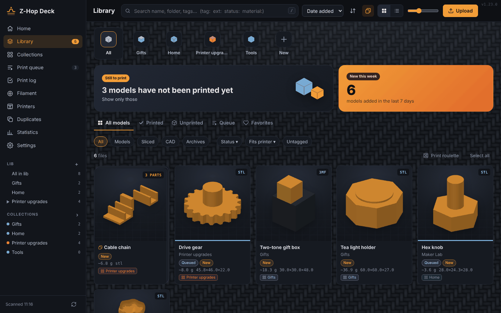
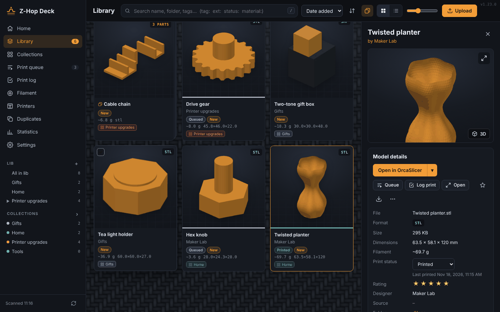

# User guide

- [First steps](#first-steps)
- [Home](#home)
- [Library](#library) – browsing, search, model folders, the details panel
- [Getting files in](#getting-files-in)
- [Organising](#organising) – collections, tags, status, moving files
- [3D viewer](#3d-viewer)
- [Slicers](#slicers) – *Open in slicer*, uploading from OrcaSlicer
- [Printers](#printers)
- [Print queue and print log](#print-queue-and-print-log)
- [Filament and Spoolman](#filament-and-spoolman)
- [Statistics and duplicates](#statistics-and-duplicates)
- [Settings](#settings)
- [Keyboard shortcuts](#keyboard-shortcuts)

---

## First steps

1. Open Z-Hop Deck in the browser. The first scan of your model folder starts by itself; progress is shown at the bottom of the left menu. Previews appear one by one while it works.
2. **Settings → Slicers**: tick the slicers installed on your PC (OrcaSlicer and Cura are on by default).
3. **Printers → Add printer**: enter the build volume of each printer. With a network connection (Moonraker, OctoPrint, PrusaLink) you also get live status and *Send to printer*.
4. **Filament**: add your spools, or connect Spoolman under **Settings → Spoolman**.
5. **Settings → Costs**: currency, electricity price, spool price – used for the cost of each print.

## Home

The start page shows what needs your attention:

| Card | |
|---|---|
| **Your library** | Number of models, printed models, prints in the queue and printers – click a number to open that list. Next to it, the model you printed last. |
| **Needs you** | Queued prints for which no spool has enough filament of the right material. |
| **Spools** | Filament left in total and per spool; how many are running low. |
| **Runs out soon** | Spools that will be empty within 90 days at the rate your logged prints used them in the last 30 days. |
| **Up next** | The first job in the print queue. |
| **New in your library** | The latest models. A model folder opens as thumbnails of its files. |
| **This month** | Prints, success rate and filament this month; the bars are the last four weeks. |
| **Printers** | Live state of connected printers and the loaded spool. |

## Library

**At the top:** your collections as tiles (click one to show only it, *All* to go back, *+ New* to create one), two shortcuts – what is ready or still waiting to be printed, and what was added this week – and the tabs **All models · Printed · Unprinted · Queue · Favorites**.

**Filters:** file type (Models, Sliced, CAD, Archives), status, *Fits printer* (only models that fit the build volume of that printer), untagged. In the toolbar: sort order, grid or list, card size, and ⧉ to show model folders as one card or every file separately.

**Search** finds names, folders, notes, designers and tags. Special filters:

| | |
|---|---|
| `tag:benchy` | files with that tag (`*` works as wildcard) |
| `ext:3mf` | file type |
| `status:printed` | `want`, `queued`, `printing`, `printed`, `failed` |
| `material:petg` | material from the slicer data |
| `designer:name` | designer |
| `-word` | exclude |

**Cards** show the preview, the designer (or folder), status pills (*Printed*, *Queued*, *Ready to print*, *New*), filament and size, and the collections the model is in – click a collection chip to open it.

**One click on a file** opens the details panel on the right:

- the preview with **3D** (or **Toolpath** for G-code) and ⤢ for the full view,
- photos from the model's folder (click for a gallery),
- **Open in OrcaSlicer** (▾ for your other slicers), **Send to printer** for G-code,
- **Queue**, **Log print**, **Open** (full page), favourite, download, more actions,
- file, format, size, dimensions, print time, filament, **print status**, **rating**, designer, source, folder, tags, collections and notes.

**Double-click** a card to go straight to the full 3D page. There you have tabs for the overview, printing (history, cost estimate, printers it fits), editing (title, designer, license, source URL, notes, tags, move/rename) and the other files in the folder. ← and → step through the models.

### Model folders

A folder with several parts is shown as **one card** with all parts laid out on the plate and the number of parts. Clicking it opens the folder: the parts as cards, plus its photos, PDFs and text files. Subfolders that hold only pictures (like `images/` in a Printables download) appear as a folder card instead of mixing into the parts. Text and Markdown files open in a reader, images in a gallery, PDFs in the browser.

The header of an open model folder has **All parts in 3D**, **Queue all**, **Zip** (download everything) and **⋯** for tags, collections, renaming and ungrouping.

Folders you upload, and ZIPs extracted on upload, become model folders automatically. For folders you copied to the server yourself, right-click the folder in the left menu → **Treat folder as one model** or **Treat each subfolder as a model**.

## Getting files in

- **Upload in the browser:** the **Upload** button, or drag files or whole folders anywhere onto the page. Choose the destination folder (or type a new subfolder), tags and a collection. A dropped folder or ZIP becomes one model; ZIPs are extracted and then deleted.
- **Copy them to the server** into your model folder with SMB, SFTP, rsync, Syncthing… They appear after the next automatic scan, or right away with ⟳ at the bottom of the menu.

Moved or renamed files are recognised by their content, so tags, notes and print history stay with them.

## Organising

| | |
|---|---|
| **Collections** | Groups of files across folders – a file can be in several. A collection is only a label: the files stay in their folder. Add files with right-click → *Add to collection…*, by dragging cards onto a collection in the left menu, in the *Move* dialog, or while uploading (the open collection is preselected). Remove with right-click → *Remove from collection…*. |
| **Tags** | Coloured labels. Click a tag on a card to filter by it; rename a tag to merge two. Manage them in the left menu. |
| **Status** | Want to print · Queued · Printing · Printed · Failed. Set it in the panel or for many files at once; queueing and logging prints update it for you. |
| **Rating, favourite, notes** | In the details panel. |
| **Move / rename** | Right-click → *Move*, drag cards onto a folder in the left menu, or the *Edit* tab. Files are moved on disk. |
| **Batch** | Ctrl/Shift-click or Ctrl+A to select, then right-click or use the bar at the bottom: tags, status, collection, queue, move, download as ZIP, regenerate previews, delete. |
| **Delete** | Deleted files go to the trash (Settings → Trash) and can be restored from `data/trash/` until you empty it. |

## 3D viewer

Drag to rotate, right-drag to pan, scroll to zoom. The toolbar: reset view, Front / Top / Side, wireframe, colour, auto-rotate, build plate on/off, **use current view as the thumbnail**, fullscreen. The grid is at least the size set in Settings → Library and grows to fit the model.

- **Multi-colour 3MF** (Bambu Studio, OrcaSlicer, PrusaSlicer projects, painted models) are shown in their filament colours. The legend lists the filament number and name from the project.
- **G-code** shows the toolpath coloured by feature (outer wall, infill, support…) like OrcaSlicer, with a **layer slider**.
- **STEP** and **OpenSCAD** files are converted on the server the first time you open them.
- *All parts in 3D* lays out every part of a model folder on one plate.

## Slicers

### Open in slicer

The buttons hand the file to the slicer on the PC you are browsing from – no download and re-import. The slicer must be installed there (its installer registers the link type) and that PC must reach Z-Hop Deck. OpenSCAD files are sent as the rendered STL. OrcaSlicer, PrusaSlicer and Bambu Studio open STL, 3MF, OBJ and STEP; Cura opens STL, 3MF and OBJ.

### Upload from OrcaSlicer

> Step-by-step setup with automatic print logging and troubleshooting: **[OrcaSlicer: upload, print and log automatically](orcaslicer.md)**.

Z-Hop Deck can act as the print host in OrcaSlicer (it answers like OctoPrint):

1. **Settings → OrcaSlicer upload** in Z-Hop Deck shows a URL for each printer and the API key.
2. In OrcaSlicer, open the printer's connection settings (the Wi-Fi icon next to the printer): **Host type** `Octo/Klipper`, paste the URL (use the direct `http://<server>:8080/p/<id>` address, not one behind a login portal) and the API key, **Test**.
3. **Upload** in OrcaSlicer now stores the G-code in your library next to the model it was sliced from and passes it on to that printer.

By default the print is **not** started even with *Upload and Print* – handy with a multi-material unit where you pick the lane on the printer first. Change it under *"Upload and Print" in Orca*. OrcaSlicer's *Device* tab shows the uploaded file in Z-Hop Deck.

## Printers

**Printers → Add printer**: name, build volume, power draw (for the electricity cost) and optionally a network connection:

| Type | Address | API key |
|---|---|---|
| Klipper / Moonraker | the printer's IP, e.g. `http://192.168.1.30` | only if Moonraker authorization is on |
| OctoPrint | e.g. `http://octopi.local` | OctoPrint → Settings → Application Keys |
| PrusaLink | printer IP | printer → Settings → Network → PrusaLink |

Use **Test connection** before saving. If the printer's web page is behind a login portal, enter its IP as the address and the nice domain as **Web address for the browser** – the *Open Mainsail* button uses that one.

Connected printers show state, progress, time left, temperatures and (Moonraker with `[spoolman]`) the loaded spool. **Send to printer** uploads G-code and can start the print. Bambu Lab printers use a different protocol: open the model in OrcaSlicer or Bambu Studio and print from there.

## Print queue and print log

**Print queue:** add from the panel, the right-click menu or a model folder (*Queue all*). Drag to reorder, set copies, spool and printer per job; totals for time, filament and cost. *Printed ✓* logs the print and removes the job.

**Print log:** every print with result (success, failed, cancelled), copies, filament, time, printer, spool, cost and notes. Logging deducts the filament from the spool.

**Automatic print log** (Settings → OrcaSlicer upload, [setup guide](orcaslicer.md)): for Moonraker printers, finished jobs are read from the printer's history every minute and logged with the real duration and filament used, the Spoolman spool(s) – all lanes of a multi-material print – and the cost. It works however the print was started. Don't also log those prints by hand, or they count twice.

## Filament and Spoolman

**Filament** lists your spools with colour, material, price, remaining weight and stock value; low spools are marked. Without Spoolman you manage spools here.

**Spoolman** (Settings → Spoolman): enter the address as the server reaches it (`http://<ip>:7912`). Spools are synced every few minutes with brand, material, colour, price and remaining weight, and Spoolman stays the source of truth. Optionally the app reports filament use back to Spoolman – leave that off if Moonraker already does it. *Open Spoolman* opens its web page (set a separate browser address if it is behind a proxy).

## Statistics and duplicates

**Statistics:** prints, filament and new files per month, status breakdown, file types, top tags, material use, most-printed models.

**Duplicates:** byte-identical files grouped together with the space you would free. *Keep oldest, delete others* merges their tags into the file you keep.

## Settings

| Section | |
|---|---|
| Library | Scan now, rescan interval, regenerate all previews, preview colour, minimum size of the 3D grid, missing files |
| Appearance | Theme (dark/light), background in the dark theme (your own image – upload it here –, carbon pattern or plain) |
| OrcaSlicer upload | URLs and API key, the printer for the plain URL, what *Upload and Print* does, folder for G-code without a matching model, automatic print log |
| Spoolman | Address, address for the browser, sync and usage reporting |
| Slicers | Which *Open in…* buttons to show |
| Costs | Currency, electricity price, default spool price, printer power and filament density, hourly rate |
| Backup & export | Download / restore the database, export the library as CSV |
| Trash | Size and *Empty trash* |
| Session | Who you are signed in as, logout URL of your login portal |

Theme, background and view options are remembered per browser.

## Keyboard shortcuts

| Key | |
|---|---|
| `/` | Search |
| `U` | Upload |
| `Esc` | Close the panel or view, leave a model folder, clear the selection |
| `←` `→` | Previous / next model in the full view |
| `Ctrl` + `A` | Select all |
| `Ctrl`/`Shift` + click | Select several |
| `Del` | Delete the selection (to the trash) |
